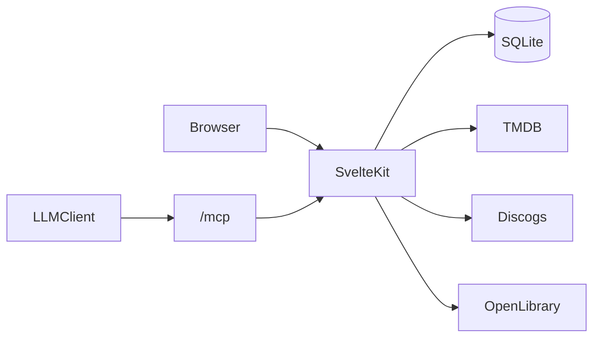

# Architecture

## Overview

Media Club is a SvelteKit 2 application with:

- **Public read** routes for browsing collections, wishlists, and the show tracker
- **Admin-only write** routes protected by session cookies
- **Server-side API proxies** for TMDB, Discogs, and Open Library
- **HTTP MCP endpoint** for LLM clients (Bearer token auth)
- **SQLite** via Drizzle ORM (Cloudflare D1 or local file)

## Data model

### Core catalog (`items`)

Single `items` table with discriminated `category` and `list_type`:

| Column        | Purpose                                            |
| ------------- | -------------------------------------------------- |
| `category`    | `movie`, `show`, `music`, `book`                   |
| `list_type`   | `owned`, `wishlist`                                |
| `album_id`    | Optional collection assignment (owned items only)  |
| `external_id` | Provider ID (TMDB, Discogs, Open Library work key) |
| `metadata`    | JSON blob for genres, watch providers, etc.        |

Unique constraint on `(category, external_id, list_type)` prevents duplicates.

### Collections (`albums`)

User-defined shelves per category (e.g. "Marvel marathon", "90s jazz"). One collection per owned item. Routes under `/albums/[category]`.

### Show tracker (`show_tracker_items`)

Separate from owned/wishlist catalog. Tracks TV series the admin is **watching** or **upcoming**, without requiring them to be in the permanent collection. Route: `/shows/watching`.

### Streaming admin lists

Admin-only watchlists (`streaming_lists`, `streaming_list_items`) with TMDB provider metadata. Not part of the public catalog. Routes under `/admin/streaming`.

### Auth

`admin_user` + `session` tables. Only one admin account is seeded; there is no public registration.

## Auth flow

1. Admin posts username/password to `/login`
2. Server verifies PBKDF2 password hash
3. Session token stored in HTTP-only cookie and `session` table
4. `hooks.server.ts` validates session on each request
5. Mutations check `locals.user`; API search returns 401 without session

## Database adapters

| Environment        | Storage                                      |
| ------------------ | -------------------------------------------- |
| `npm run dev`      | `./data/media-club.db` via better-sqlite3    |
| Cloudflare Workers | D1 binding `DB`                              |
| Docker             | `/app/data/media-club.db` via better-sqlite3 |

`getDb()` in `src/lib/server/db/index.ts` picks the backend based on `platform.env.DB`.

## MCP integration

HTTP streamable transport at `/mcp`. Requires `Authorization: Bearer MCP_API_KEY`.

14 tools cover search, CRUD, collection management, and catalog stats. Tool handlers reuse the same server-side services as the web UI. See [mcp-setup.md](./mcp-setup.md).

## Security

- API keys server-side only
- Rate limiting on `/api/search` and MCP search (30 req/min per IP)
- CSRF protection via SvelteKit form actions
- Security headers in `hooks.server.ts`
- No open sign-up

## Extending categories

Adding a new media type (e.g. games) requires:

1. New `category` enum value in the schema
2. A search provider in `src/lib/server/apis/`
3. A route page and nav link

The unified `items` schema avoids per-type tables.

## Testing

151 Vitest unit tests across server logic, MCP handlers, TMDB client, and UI utilities. Run `npm test`.
